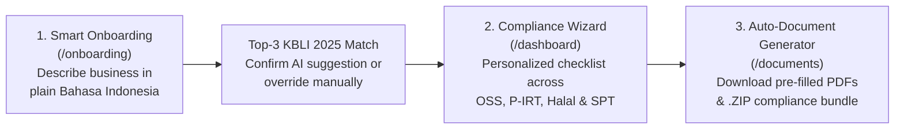
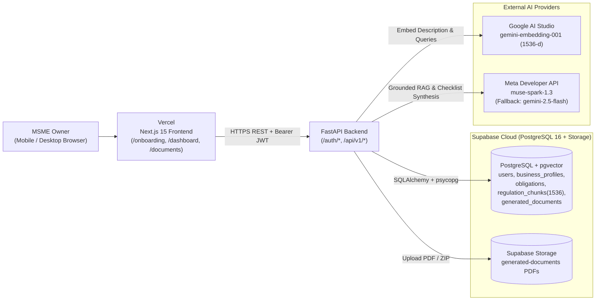

# Legalyst — AI-Powered Regulatory Compliance Copilot for Indonesian MSMEs

[](https://github.com/altafparves/Legalyst/actions/workflows/ci.yml)

> **Become a Legalyst yourself.**  
> Helping Indonesian F&B and retail micro and small businesses (UMKM) identify their official **KBLI 2025** classification, understand their **OSS-RBA, P-IRT, Halal, and Tax (SPT)** obligations in plain Bahasa Indonesia with **100% regulatory citations**, and auto-generate ready-to-sign **PDF draft documents**.

---

## 🌐 Live Deployment & Documentation Links

| Environment / Resource | URL | Description |
| :--- | :--- | :--- |
| **Frontend Application (Vercel)** | [https://legalyst-frontend.vercel.app](https://legalyst-frontend.vercel.app) | Next.js 15 mobile-first web application (`/onboarding`, `/dashboard`, `/documents`) |
| **Backend API Base URL** | [https://legalyst.vercel.app](https://legalyst.vercel.app) | FastAPI backend service |
| **Interactive API Docs (Swagger UI)** | [https://legalyst.vercel.app/docs](https://legalyst.vercel.app/docs) | OpenAPI v1 specification and interactive endpoint tester |
| **API Health Check** | [https://legalyst.vercel.app/health](https://legalyst.vercel.app/health) | Service readiness probe (`{"status": "ok"}`) |
| **Database Health Check** | [https://legalyst.vercel.app/health/db](https://legalyst.vercel.app/health/db) | PostgreSQL `SELECT 1` keep-alive probe (`{"status": "ok", "database": "ok"}`) |
| **Project Documentation Site** | [`docs/index.md`](docs/index.md) | Capstone PRD, wireframes, ERD, and sprint roadmap |

---

## 👥 Team & Roles (Capstone Group)

| Name | NIU / Student ID | Role | Key Ownership |
| :--- | :--- | :--- | :--- |
| **Altaf Parves Shua Ilham** | `24/536741/TK/59565` | **Backend Engineer** | FastAPI Architecture, PostgreSQL + `pgvector` Schema, JWT Auth, Rule Engine, PDF Generator, Supabase & Cloud CI/CD |
| **M Dimas Dwi Ananda** | `24/536904/TK/59594` | **Frontend Engineer** | Screen 3 (`/documents` Auto-Document Generator), Mobile Navigation & WCAG 48px Audit, MSME Usability Testing |
| **Diffie Alfierie Iswanto** | `24/533049/TK/59056` | **Frontend Engineer** | Next.js App Shell, Auth Wiring, Screen 1 (`/onboarding` KBLI Profiler) & Screen 2 (`/dashboard` Compliance Wizard) |
| **Calvin** | `24/532894/TK/59025` | **AI Engineer** | KBLI 2025 Semantic Profiler (`gemini-embedding-001`), Meta LLM (`muse-spark-1.3`) RAG Synthesis & Re-ranking, Evaluation Pipeline |

---

## 📌 Problem Statement

Indonesian micro and small businesses (UMKM) in the **Food & Beverage (F&B)** and **Retail** sectors face fragmented regulations across multiple government agencies:
1. **Business Licensing (NIB & Risk Tiers)** via **OSS-RBA** (Kementerian Investasi / BKPM)
2. **Sector Classification** via the **5-digit KBLI 2025 Codebook** (BPS)
3. **Home Food Safety Permits (SPP-IRT / SLHS / BPOM)** via **Dinas Kesehatan & BPOM**
4. **Halal Certification (Self-Declare / SEHATI)** via **BPJPH Kemenag**
5. **MSME Final Income Tax (PPh Final 0.5% & Annual SPT)** via **Ditjen Pajak**

Official government portals assume business owners already know their 5-digit KBLI code and dense legal terminology, while private legal consultants (e.g., Easybiz.id, Justika.com) are priced far beyond a home producer or warung budget. **Legalyst bridges this gap for free.**

---

## 🚀 Core User Journey (What Users Can Do)

Legalyst guides an MSME owner from zero legal knowledge to downloadable compliance documents in **3 simple steps**:



### Step 1: Smart Onboarding & KBLI 2025 Profiler (`/onboarding` — FR 1 to FR 3)
* **User Action:** Types a casual description of their business in everyday Bahasa Indonesia (e.g., *"Saya bikin keripik pisang aneka rasa dari dapur rumah, dijual lewat WA dan titip di warung"*).
* **System Action:** Embeds the description using **Google AI `gemini-embedding-001`** (`1536` dimensions, L2-normalized) and matches it against the 313 F&B/Retail codes in `data/kbli_2025.csv` (with optional **Meta `muse-spark-1.3`** re-ranking).
* **Result:** Displays the **Top-3 KBLI 2025 candidate cards** with confidence scores and risk tiers (*Risiko Rendah / Menengah / Tinggi*). The user confirms one or searches manually to override (`FR 3`), saving their **Business Profile**.

### Step 2: Interactive Compliance Wizard (`/dashboard` — FR 4 to FR 8)
* **User Action:** Reviews their personalized checklist filtered by track (**Semua**, **OSS-RBA**, **P-IRT**, **Halal**, **SPT**), inspects legal citations, and asks follow-up compliance questions.
* **System Action:**
  1. **Deterministic Rule Engine (`FR 4`):** Filters the `obligations` table by confirmed 5-digit KBLI 2025 code, business scale (`mikro` / `kecil`), and OSS risk tier.
  2. **Vector Retrieval (`FR 5`):** Retrieves relevant regulatory clauses from `regulation_chunks` via PostgreSQL `pgvector` cosine similarity (`<=>`).
  3. **Grounded LLM Synthesis (`FR 6`):** Uses **Meta `muse-spark-1.3`** (`reasoning_effort=minimal`, fallback to `gemini-2.5-flash`) to explain each requirement in plain, jargon-free Bahasa Indonesia.
  4. **Anti-Hallucination Guardrails (`FR 7 & FR 8`):**
     * **100% Source Citations (`FR 7`):** Every item displays a clickable regulation badge (e.g., `[PP No. 5/2021 Pasal 12]`) linking directly to the official legal article and URL.
     * **Transparent Ambiguity Flagging (`FR 8`):** Conditional or regional requirements that cannot be auto-confirmed are flagged with an amber **`⚠️ Perlu Verifikasi Manual`** badge rather than silently omitted.

### Step 3: Auto-Document Generator (`/documents` — FR 9 to FR 11)
* **User Action:** Clicks **"Unduh PDF"** on individual compliance drafts or **"Unduh Semua Dokumen (.ZIP)"**, then follows the step-by-step physical submission guide (*Materai Rp10.000 → oss.go.id → SiHalal*).
* **System Action:** Populates standardized Indonesian regulatory templates with the user's confirmed Business Profile (`business_name`, `kbli_code`, KBLI title, `description`, `risk_tier`, date, and legal disclaimer banner), renders them to PDF, uploads them to **Supabase Storage (`generated-documents` bucket)**, and serves individual PDFs or a bundled `.zip` archive:
  1. **Surat Pernyataan Mandiri Usaha Mikro** (OSS-RBA / BKPM standard)
  2. **Formulir Komitmen Sanitasi & Higienitas P-IRT** (Dinas Kesehatan standard)
  3. **Surat Ikrar Bebas Bahan Kritis Halal** (BPJPH Self-Declare / SEHATI standard)

---

## 🧠 AI, Cloud & Tech Stack Mapping (Why We Built It This Way)

| Layer / Feature | Technology / Model Used | Engineering Rationale |
| :--- | :--- | :--- |
| **Frontend Web App** | **Next.js 15 (App Router, TypeScript, Tailwind CSS v4)** on **Vercel** | Mobile-first UI with ≥ 48px touch targets for MSME smartphone users; zero-config global CDN deployment. |
| **Backend API** | **FastAPI (Python 3.12, SQLAlchemy 2.0, Alembic, Pydantic v2)** on **Vercel / Render** | Typed REST endpoints (`/api/v1/*`), OpenAPI contract validation, JWT authentication, and in-process `BackgroundTasks`. |
| **Database & Vector Store** | **Supabase PostgreSQL 16 + `pgvector`** (Docker Postgres locally) | Unified relational store (`users`, `business_profiles`, `obligations`, `generated_documents`) and HNSW cosine vector index (`regulation_chunks.embedding vector(1536)`). |
| **File Storage (PDFs)** | **Supabase Storage** (`generated-documents` bucket) | S3-compatible bucket for generated compliance PDFs and signed download URLs. |
| **Semantic Embeddings** | **Google AI Studio (`gemini-embedding-001`)** via `google-genai` | Configured at `output_dimensionality=1536` with L2 normalization (`RETRIEVAL_DOCUMENT` / `RETRIEVAL_QUERY`). Achieved **100% Top-3 accuracy** (90% Top-1) on `data/kbli_eval.csv`. |
| **LLM Generation, RAG & Re-ranking** | **Meta Developer API (`muse-spark-1.3`)** + **Google `gemini-2.5-flash` (Fallback)** | OpenAI-compatible client (`https://api.meta.ai/v1`) with `reasoning_effort=minimal` (cuts latency to ~3.1s, reduces token cost by 75%, and reaches **100% Top-1 accuracy** when re-ranking). Automatic fallback to Gemini 2.5 Flash guarantees high availability. |
| **PDF Document Rendering** | **Deterministic Python PDF Templates** + Profile Injection | Government forms require strict statutory wording. Template rendering is instant (< 0.2s), costs $0 in LLM tokens, and eliminates legal hallucination risk. |
| **No OCR Required** | **Plain-Text Bahasa Indonesia Profiler** | Target MSMEs are first-time permit applicants starting from zero. Typing a 1–2 sentence business description works on any low-end smartphone without camera/document upload friction. |

---

## 🏗️ System Architecture



---

## 📂 Repository Structure

```text
Legalyst/
├── backend/                  # FastAPI backend service
│   ├── alembic/              # Database migrations (PostgreSQL + pgvector)
│   ├── app/
│   │   ├── routers/          # API routes (/health, /auth, /api/v1/*)
│   │   ├── services/         # Business logic (embeddings, profiler, checklist, PDF generator)
│   │   ├── config.py         # Environment variable settings
│   │   ├── db.py             # SQLAlchemy engine & session management
│   │   ├── models.py         # ORM models (User, BusinessProfile, Obligation, RegulationChunk, GeneratedDocument)
│   │   └── schemas.py        # Pydantic v2 request/response contracts
│   ├── scripts/              # pgvector corpus ingestion & cosine retrieval verification
│   └── tests/                # Pytest test suite
├── frontend/                 # Next.js 15 frontend application
│   ├── app/
│   │   ├── (auth)/           # /login and /register pages
│   │   └── (app)/            # /onboarding (Step 1), /dashboard (Step 2), /documents (Step 3)
│   ├── components/           # Shared UI components (ComplianceStepper, CitationBadge, DisclaimerBanner, BottomNav)
│   └── lib/                  # API client, JWT auth helpers, and TypeScript contracts
├── data/                     # Curated regulatory datasets & evaluation benchmarks
│   ├── kbli_2025.csv         # 313 F&B and Retail 5-digit KBLI 2025 codes
│   ├── kbli_vectors.npy      # Cached (313, 1536) L2-normalized KBLI embeddings
│   ├── kbli_eval.csv         # 20-row Indonesian MSME evaluation benchmark
│   ├── obligations_oss.csv   # Compiled OSS-RBA regulatory obligations with citations
│   └── TEMPLATE_obligations.csv
├── scripts/                  # Offline AI evaluation scripts (BM25 baseline, Gemini embeddings, Meta re-ranking)
├── docs/                     # Architecture, DB schema ERD, AI stack research, and UI design specs
└── docker-compose.yml        # Local PostgreSQL 16 + pgvector container (port 55432)
```

---

## ⚡ Quick Start (Local Development)

### 1. Prerequisites
* **Python 3.12 or 3.13** (for FastAPI backend)
* **Node.js 20+** & **npm** (for Next.js frontend)
* **Docker Desktop** (for local PostgreSQL 16 + `pgvector`, or point `DATABASE_URL` to Supabase)

### 2. Start the Database & Run Migrations
```bash
# From the repository root:
docker compose up -d postgres

cd backend
python3.12 -m venv .venv
source .venv/bin/activate
pip install -r requirements.txt
cp .env.example .env

# Run Alembic migrations to create tables + vector(1536) HNSW index
alembic upgrade head

# (Optional) Ingest regulatory obligations & embeddings into pgvector
python scripts/ingest_regulations.py
```

### 3. Run the FastAPI Backend
```bash
cd backend
source .venv/bin/activate
uvicorn app.main:app --reload --port 8000
```
* **API Health Check:** `http://localhost:8000/health`
* **Interactive OpenAPI Docs (Swagger UI):** `http://localhost:8000/docs`

### 4. Run the Next.js Frontend
```bash
cd frontend
npm install
cp .env.example .env.local
npm run dev
```
* **Web App:** `http://localhost:3000`

---

## 🧪 Running Tests & Quality Checks

```bash
# Backend Linting & Unit Tests
cd backend
ruff check .
pytest

# Frontend Linting & Production Build Check
cd frontend
npm run lint
npm run build
```

---

## 📚 Detailed Documentation

* [**Project Overview & PRD (`docs/index.md`)**](docs/index.md) — Product goals, user personas, FR 1–11, and wireframes.
* [**Cloud Infrastructure & Deployment (`docs/infra.md`)**](docs/infra.md) — Vercel, Render, and Supabase setup, environment variables contract, and free-tier keep-alive strategy.
* [**AI Stack Decisions (`docs/ai-stack.md`)**](docs/ai-stack.md) — Meta `muse-spark-1.3` + Google `gemini-embedding-001` architecture and data readiness.
* [**Meta & Embedding Benchmark Research (`docs/meta-model-research.md`)**](docs/meta-model-research.md) — BM25 vs. Embedding vs. Hybrid vs. LLM Re-ranking accuracy, latency, and token cost experiments.
* [**Database Schema & ERD (`docs/schema.md`)**](docs/schema.md) — Entity-Relationship Diagram and table definitions.
* [**Frontend Slicing Guide (`frontend/SLICING_GUIDE.md`)**](frontend/SLICING_GUIDE.md) — Screen-by-screen UI guide for Frontend developers.

---

## ⚠️ Legal Disclaimer
*Legalyst menyediakan informasi kepatuhan dan draf dokumen secara otomatis sebagai panduan awal bagi pelaku UMKM, **bukan merupakan nasihat atau pendapat hukum resmi**. Selalu verifikasi dokumen akhir pada portal resmi pemerintah (`oss.go.id`, `sppirt.pom.go.id`, `ptsp.halal.go.id`, dan `pajak.go.id`).*
