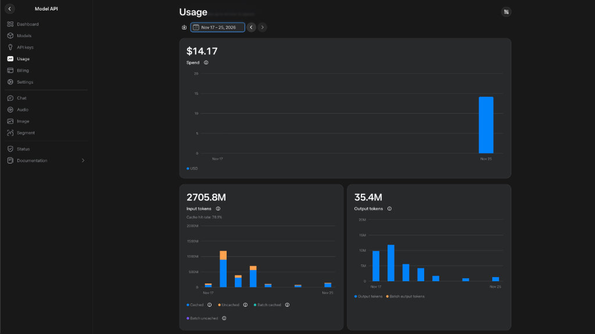
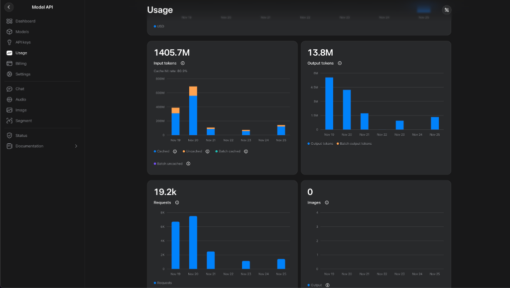
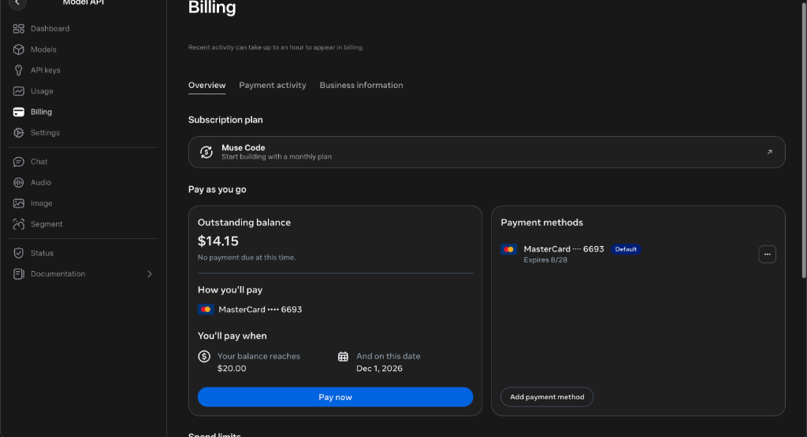

# Incident Report: Meta Developer API Key Exposure & Credit Exhaustion

**Date:** November 26, 2026  
**Author:** Altaf Parves  
**Status:** All Meta API Keys Permanently Revoked · Billing Dispute Submitted to Meta Support  
**Related Ticket / PR:** `#57`, `#63`, PR `#58` (`feat/kbli-profiler`)

---

## 1. Executive Summary

Between **November 17 and November 25, 2026**, **my personal $150.00 USD Meta Developer API credit** (which I provided from my personal hackathon account so we could run our Senior Project LLM workloads at zero cost) was **completely drained to $0.00**, and **my personal MasterCard was subsequently billed an additional $14.15 USD** in unauthorized usage.

In total, an external automated scraper consumed **2,705.8 Million (2.7 Billion) input tokens** and **35.4 Million output tokens** across **19,200+ requests** using our leaked key.

To prevent any further charges to my personal bank card, **I have permanently revoked all Meta API keys on my account**. As a consequence, the Meta Developer Platform (`muse-spark-1.3`) is no longer available for this Senior Project, and we are forced to transition to another model/provider immediately.

---

## 2. Root Cause & Git History Evidence

An audit of our repository's commit log and the Meta Developer Platform usage dashboard confirmed that the key leak occurred on **November 15, 2026**, during the KBLI Profiler evaluation work on branch `feat/kbli-profiler`.

### A. The Commit That Exposed the Live API Key
- **Commit:** [`eb416136b6c8de5bf8f5a251c2501ecf4b9f9e24`](https://github.com/altafparves/Legalyst/commit/eb416136b6c8de5bf8f5a251c2501ecf4b9f9e24)
- **Author:** `Calvin <calvin1042@gmail.com>`
- **Timestamp:** `Sun, Nov 15, 2026 at 22:27:41 +0700 (WIB)`
- **Commit Message:** `"Record accuracy comparison, reasoning effort test, embedding re-rank experiment"`

In commit [`eb41613`](https://github.com/altafparves/Legalyst/commit/eb416136b6c8de5bf8f5a251c2501ecf4b9f9e24), the actual live secret key (`META_API_KEY=LLM_1659173199167501_...`) was pasted directly into [`.env.example`](../.env.example) and pushed to our **public** GitHub repository (`altafparves/Legalyst`):

```diff
commit eb416136b6c8de5bf8f5a251c2501ecf4b9f9e24
Author: Calvin <calvin1042@gmail.com>
Date:   Sun Nov 15 22:27:41 2026 +0700

    Record accuracy comparison, reasoning effort test, embedding re-rank experiment

diff --git a/.env.example b/.env.example
index 5754cb7..26322e3 100644
--- a/.env.example
+++ b/.env.example
@@ -1,3 +1,7 @@
 GEMINI_API_KEY=
 GEMINI_EMBED_MODEL=gemini-embedding-001
-GEMINI_EMBED_DIM=1536
+GEMINI_EMBED_DIM=1536
+META_API_KEY=LLM_1659173199167501_KFM4DwlpHQPlbebIIClcbv3caDk
+META_BASE_URL=https://api.meta.ai/v1
+META_MODEL=muse-spark-1.3
+META_REASONING_EFFORT=minimal
```

### B. Direct Contradiction With the Research Documentation in the Same Commit
What makes this exposure particularly unfortunate is that the security requirement was already known and explicitly written down by Calvin in [`docs/meta-model-research.md`](meta-model-research.md) (**Section 3, Line 39**), which was tracked in the exact same branch and commit:

> **From [`docs/meta-model-research.md` (Line 39)](meta-model-research.md#L39):**  
> `- Env vars (names only, values stay in the local .env): META_API_KEY, META_BASE_URL, META_MODEL, META_EMBED_MODEL, META_REASONING_EFFORT`

Furthermore, in [`.env.example`](../.env.example), `GEMINI_API_KEY=` on line 1 was properly left empty, whereas `META_API_KEY=` on line 4 was populated with my live API key and pushed to a public repository.

### C. Why My Subsequent Cleanup Commit (`8344fb7`) Could Not Undo the Public Exposure
- **Cleanup Commit:** [`8344fb755430089e0b77d468fedd7a6222d0d4a1`](https://github.com/altafparves/Legalyst/commit/8344fb755430089e0b77d468fedd7a6222d0d4a1)
- **Author:** `Altaf Parves <altafparvesh@gmail.com>`
- **Timestamp:** `Mon, Nov 16, 2026 at 00:10:03 +0700 (WIB)` (*1 hour and 42 minutes after `eb41613`*)
- **Commit Message:** `"fix: remove leaked META_API_KEY from .env.example and resolve pydantic dependency conflict"`

When reviewing PR `#58` late that night, I noticed the leaked key in `.env.example` and immediately pushed commit [`8344fb7`](https://github.com/altafparves/Legalyst/commit/8344fb755430089e0b77d468fedd7a6222d0d4a1) to strip the value from the file:

```diff
-META_API_KEY=LLM_1659173199167501_KFM4DwlpHQPlbebIIClcbv3caDk
+META_API_KEY=
```

However, in Git, **removing a line in a new commit does not delete the earlier commit ([`eb41613`](https://github.com/altafparves/Legalyst/commit/eb416136b6c8de5bf8f5a251c2501ecf4b9f9e24)) from the public repository history**. Because the key was not revoked on `dev.meta.ai` at that time so that local development wouldn't be interrupted, automated GitHub secret-scanning bots scraped `LLM_1659173199167501_...` directly from commit `eb41613`.

---

## 3. Timeline & Financial Impact (Nov 15 – Nov 25, 2026)

| Date | Event | Token / Request Volume | Cost Impact |
| :--- | :--- | :--- | :--- |
| **Nov 15 (22:27 WIB)** | Actual Legalyst evaluation scripts (`test_models.py`, `test_reasoning.py`, `eval_matcher.py`) run by Calvin + commit [`eb41613`](https://github.com/altafparves/Legalyst/commit/eb416136b6c8de5bf8f5a251c2501ecf4b9f9e24) pushed to public GitHub. | ~135 requests (~50K tokens) | **~$0.48 USD** |
| **Nov 16 (00:10 WIB)** | I stripped `META_API_KEY` from `.env.example` in commit [`8344fb7`](https://github.com/altafparves/Legalyst/commit/8344fb755430089e0b77d468fedd7a6222d0d4a1), but commit `eb41613` remained in public Git history. | — | — |
| **Nov 17 – Nov 23** | External scraper discovered the leaked key in commit `eb41613` and ran automated high-volume workloads (peaking at >1.1B tokens/day on Nov 18 and 7,000+ requests/day on Nov 19–20). | **2,705.8M input tokens**<br>**35.4M output tokens**<br>**19,200+ requests** | **Wiped out my entire $150.00 personal credit to $0.00** |
| **Nov 23 (21:58 WIB)** | Meta API automatically suspended requests with `HTTP 402: Billing verification failed` once my $150 credit hit zero. | Blocked (`HTTP 402`) | Credit exhausted |
| **Nov 25** | Unaware that the key had been scraped, I linked my personal MasterCard (`•••• 6693`) to resolve the `HTTP 402` billing hold. The attacker's automated script immediately resumed and burned through another ~150M input tokens before I caught it. | ~1,500 requests (~150M input / ~1.4M output tokens) | **+$14.15 USD billed to my personal MasterCard** |
| **Nov 26 (00:15 WIB)** | I permanently revoked all Meta API keys (`HTTP 401`) and submitted a formal billing waiver ticket to Meta Support. | Terminated | All keys revoked |

---

## 4. Dashboard Evidence

### A. Meta Usage Dashboard (Nov 17 – Nov 25, 2026): 2,705.8M Input Tokens & 35.4M Output Tokens


### B. Request Volume Breakdown (Nov 19 – Nov 25, 2026): 19.2k Requests


### C. Meta Billing Dashboard: $14.15 USD Outstanding Balance on My Personal MasterCard
*(Note: The $0 spend bars prior to Nov 25 were deducted against my $150 promotional credit until it hit $0 on Nov 23. As soon as I linked my MasterCard on Nov 25 to clear the billing hold, the leaked key immediately accrued $14.15 in pay-as-you-go charges on my card.)*



---

## 5. Moving Forward & Open Questions for Our Senior Project

Because **my personal $150 Meta credit is completely gone** and my card is currently facing a **$14.15 charge** from this leak, all Meta API keys have been permanently deleted and we can no longer use `muse-spark-1.3` for Legalyst.

To keep our Senior Project on track for next week's presentation, we need to align on the following right away:

1. **Replacement LLM for Phase 5 (`#63` / `#68` / `#87` / `#88`):**  
   Since we are now forced to find and use another model for this Senior Project (RAG Compliance Checklist synthesis and Grounded Q&A), earlier we documented **Google AI Studio (`gemini-2.5-flash`)** as our zero-cost fallback in [`docs/ai-stack.md`](ai-stack.md).  
   - **Question for Calvin:** Do you agree with switching Phase 5 (`ai_client.py`, `answer_compliance_question`, and `generate_document_draft`) completely over to **`gemini-2.5-flash`**, or do you have another model / personal API credit you would like to provide to replace the lost Meta API credit?
2. **Strict Secret Hygiene Going Forward:**  
   - Never paste real API keys (`GEMINI_API_KEY`, `SUPABASE_SERVICE_ROLE_KEY`, `DATABASE_URL`, etc.) into `.env.example`, test scripts, markdown docs, or commit messages.
   - Before every `git commit` and `git push`, always run `git diff --staged` to verify that `.env.example` contains **variable names only** with empty values.
