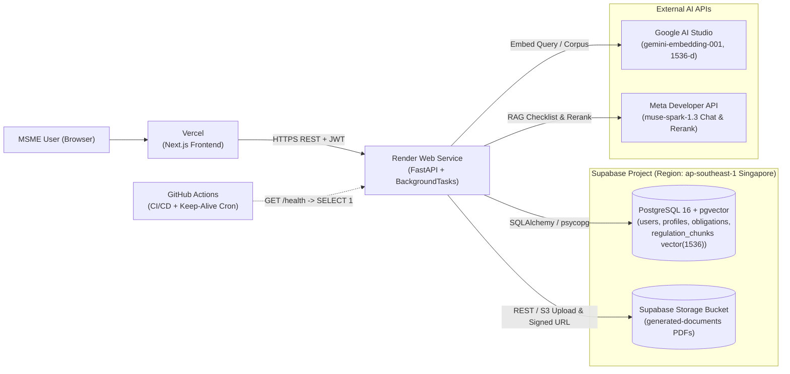

# Cloud Infrastructure & Architecture Refactor Plan

Last updated: 2026-11-16  
Supersedes: Azure assumptions in `#5`, `#10`, `#19`, `#32`, `#34`, `#42`

---

## 1. Background & Why We Refactored Away from Azure

The original module brief assigned a Cloud Engineer scope targeting **Microsoft Azure** (App Service, Azure Database for PostgreSQL Flexible Server, Azure Blob Storage, Azure Queue Storage, and Azure OpenAI). However:

1. **Azure for Students rejected `.ugm.ac.id`** tenant verification (`#5`).
2. **Department Azure credentials are not provided** to student teams (confirmed with the lab assistant).

To unblock the team without requiring paid subscriptions or credit cards that cut off after a 30-day trial (such as Railway's $5 trial cliff), Legalyst has refactored its infrastructure to an **all-free-tier, production-grade multi-cloud architecture (Option A)**.

---

## 2. Service-by-Service Replacement Matrix

| Layer / Capability | Original Azure Service | New Production Service (Free Tier) | Why We Chose It & How It Connects |
| :--- | :--- | :--- | :--- |
| **Frontend Hosting** | Azure App Service / Static Web Apps (`#19`) | **Vercel (Hobby Free)** | Native Next.js (`frontend/`) hosting, zero-config GitHub PR preview deployments, automatic HTTPS/TLS, and global Edge CDN. Never sleeps. |
| **Backend API Hosting** | Azure App Service (`#5`, `#19`) | **Render (Free Web Service)** | Hosts the Dockerized FastAPI service (`backend/`). 100% free without Railway's 30-day trial shutdown. Paired with a scheduled health-check ping to prevent cold starts during demos. |
| **Relational DB + Vector Store** | Azure Database for PostgreSQL Flexible Server + `pgvector` (`#5`) | **Supabase (Free PostgreSQL 16 + `pgvector`)** | 100% compatible with our existing SQLAlchemy models and Alembic migration (`1dda096b9349_initial_schema.py`, `vector(1536)` + HNSW cosine index). Only requires pointing `DATABASE_URL` at Supabase. |
| **Document File Storage** | Azure Blob Storage (`#32`) | **Supabase Storage (`generated-documents` bucket)** | Replaces Azure Blob inside the same Supabase project (1 GB free S3-compatible storage). Stores rendered compliance PDFs and populates `generated_documents.file_url`. |
| **Async Job Queue** | Azure Queue Storage (`#32`) | **FastAPI `BackgroundTasks`** | Runs asynchronous checklist/PDF generation in-process and updates `generated_documents.status` in Postgres, removing the need for an external message broker at MVP scale. |
| **AI Embeddings** | Azure OpenAI `text-embedding-3-small` (`#10`, `#34`) | **Google AI Studio (`gemini-embedding-001`)** | Configured with `output_dimensionality=1536` and L2 normalization in [`scripts/matcher.py`](../scripts/matcher.py). Matches `regulation_chunks.embedding vector(1536)` with zero DB schema changes. |
| **AI LLM (RAG, Rerank, Drafts)** | Azure OpenAI `GPT-4o` / `GPT-4o-mini` (`#10`) | **Meta Developer API (`muse-spark-1.3`)** + **Gemini 2.5 Flash** fallback | Uses the team's ~$150 Meta Developer API credit via an OpenAI-compatible client (`https://api.meta.ai/v1`, `reasoning_effort=minimal`). See [`docs/meta-model-research.md`](meta-model-research.md). |
| **CI/CD & Keep-Alive** | GitHub Actions → Azure (`#19`) | **GitHub Actions → Vercel / Render / Supabase** | Lints & builds on every PR (`.github/workflows/ci.yml`), runs Alembic migrations, triggers deployment hooks, and sends a periodic keep-alive ping so Supabase never hits its 7-day inactivity pause. |

---

## 3. Architecture Diagram



---

## 4. Preventing Free-Tier Sleep / Shutdowns

Free tiers on Render and Supabase have two known inactivity behaviors that we mitigate automatically:

1. **Supabase 7-day inactivity pause:** Supabase pauses free projects if zero database queries occur for 7 consecutive days.
   - **Mitigation:** Ensure FastAPI's `GET /health` (or `GET /health/db`) executes a lightweight `SELECT 1` against `DATABASE_URL`, and schedule a GitHub Actions cron workflow (or `cron-job.org` monitor) to hit `GET /health` periodically.
2. **Render 15-minute idle spin-down:** Render spins down free web services after 15 minutes of zero inbound traffic (~30s wake-up time on the next request).
   - **Mitigation:** During active testing and demo weeks, enable a 10-minute ping on `GET /health` via Uptimerobot / `cron-job.org` so the container remains warm with zero cold start.

---

## 5. Environment Variables Contract

All secrets are injected via environment variables (locally in `.env`, in CI via **GitHub Secrets**, in Frontend via **Vercel Environment Variables**, and in Backend via **Render Environment Variables**). Nothing sensitive is committed to Git.

### Backend (`backend/.env.example`)

| Variable | Service | Purpose |
| :--- | :--- | :--- |
| `APP_ENV` | FastAPI | `development` locally, `production` on Render |
| `CORS_ORIGINS` | FastAPI | Comma-separated allowed origins (e.g., `http://localhost:3000,https://legalyst.vercel.app`) |
| `DATABASE_URL` | Supabase Postgres | `postgresql+psycopg://postgres.<ref>:<password>@aws-0-ap-southeast-1.pooler.supabase.com:5432/postgres` (Session Pooler IPv4 URL for Render) |
| `JWT_SECRET_KEY` | FastAPI Auth | 32+ byte random secret for signing access tokens |
| `JWT_ALGORITHM` | FastAPI Auth | `HS256` |
| `JWT_EXPIRE_MINUTES` | FastAPI Auth | Token TTL in minutes (default `60`) |
| `SUPABASE_URL` | Supabase Storage | `https://<project-ref>.supabase.co` for uploading/serving generated PDFs |
| `SUPABASE_SERVICE_ROLE_KEY` | Supabase Storage | Server-only key used by FastAPI to upload generated PDFs to the bucket |
| `SUPABASE_STORAGE_BUCKET` | Supabase Storage | Bucket name, default `generated-documents` |
| `GEMINI_API_KEY` | Google AI Studio | API key for `gemini-embedding-001` (and fallback LLM) |
| `GEMINI_EMBED_MODEL` | Google AI Studio | `gemini-embedding-001` |
| `GEMINI_EMBED_DIM` | Google AI Studio | `1536` (must match `regulation_chunks.embedding` `vector(1536)`) |
| `META_API_KEY` | Meta Developer API | Bearer API key for `muse-spark-1.3` |
| `META_BASE_URL` | Meta Developer API | `https://api.meta.ai/v1` |
| `META_MODEL` | Meta Developer API | `muse-spark-1.3` |
| `META_REASONING_EFFORT` | Meta Developer API | `minimal` (reduces latency to ~3.1s and cuts token cost by 75%) |

### Frontend (`frontend/.env.local` / Vercel)

| Variable | Service | Purpose |
| :--- | :--- | :--- |
| `NEXT_PUBLIC_API_URL` | Render FastAPI | Base URL of the deployed FastAPI backend (e.g., `https://legalyst-api.onrender.com`) |

---

## 6. Step-by-Step Execution Checklist (GitHub Issues Refactor)

### Phase 1 — Database & Storage on Supabase (Replaces `#5` & `#32`)
- [x] Create a Supabase project in **Asia-Pacific** (`hexsfylpeqsnrwvhwgid`, `aws-1-ap-northeast-1.pooler.supabase.com`).
- [x] In Supabase SQL Editor, verify `pgvector` is enabled:
  ```sql
  CREATE EXTENSION IF NOT EXISTS vector;
  ```
- [x] Copy the **Session Pooler (IPv4 compatible, port 5432)** connection string from Supabase (`Settings → Database → Connection string → URI`) and change the scheme prefix to `postgresql+psycopg://`.
- [x] Run the existing Alembic migration against Supabase:
  ```bash
  cd backend
  DATABASE_URL="postgresql+psycopg://..." alembic upgrade head
  ```
- [x] In Supabase Dashboard → **Storage**, create a bucket named `generated-documents` (for Sprint 3 PDF output).

### Phase 2 — Backend Deployment on Vercel / Render (Replaces `#5` & `#19`)
- [x] Connect the GitHub repo (`backend/` Root Directory) to **Vercel** (`https://legalyst.vercel.app`) as a FastAPI Web Service (or Render).
- [x] Add all backend environment variables from Section 5 in the deployment dashboard.
- [x] Verify `GET https://legalyst.vercel.app/health` returns `200 OK` (`{"status":"ok"}`).

### Phase 3 — Frontend Deployment on Vercel (Replaces `#19`)
- [x] Import the GitHub repo into **Vercel** (`https://legalyst-frontend.vercel.app`) with Root Directory set to `frontend`.
- [x] Set `NEXT_PUBLIC_API_URL` / `NEXT_PUBLIC_API_BASE_URL` to the backend URL (`https://legalyst.vercel.app`).
- [x] Copy the deployed Vercel frontend domain (`https://legalyst-frontend.vercel.app`) back into the backend's `CORS_ORIGINS` env var.

### Phase 4 — Corpus & Embeddings Ingestion (Replaces `#34` / `#63`)
- [x] Run `backend/scripts/ingest_regulations.py` against Supabase `DATABASE_URL` using `gemini-embedding-001` (`1536` dims, L2-normalized) and verify cosine retrieval via `backend/scripts/verify_retrieval.py`.

