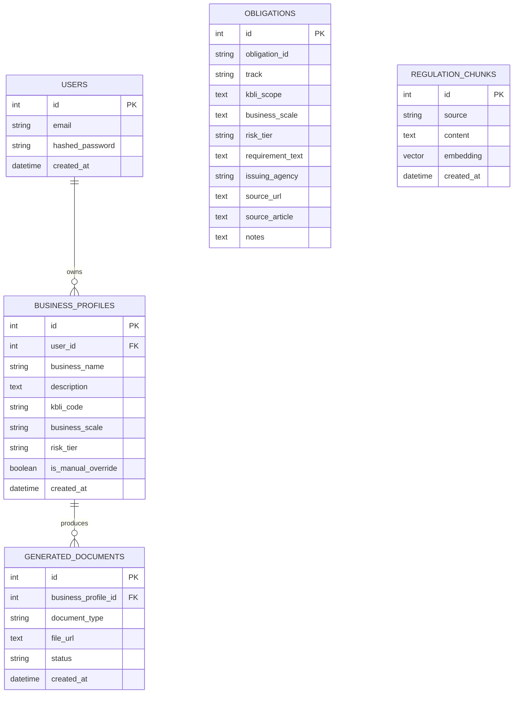

# Database Schema

**Migration:** [`backend/alembic/versions/1dda096b9349_initial_schema.py`](../backend/alembic/versions/1dda096b9349_initial_schema.py)
**Models:** [`backend/app/models.py`](../backend/app/models.py)

## ERD



## Tables

- **`users`** — auth accounts (#18).
- **`business_profiles`** — one row per user (upserted via `POST /api/v1/business-profile` and loaded via `GET /api/v1/business-profile`, #77); `kbli_code` is validated against the 313 5-digit codes in `data/kbli_2025.csv`, `business_scale` stores `'mikro'` or `'kecil'`, `risk_tier` stores the OSS-RBA risk tier, and `is_manual_override` records whether the KBLI was AI-suggested or manually overridden (`FR 3`, migration `2a8f4c1e9b01`).
- **`obligations`** — the compiled regulation corpus (OSS/PIRT/HALAL/SPT). Columns mirror [`data/TEMPLATE_obligations.csv`](../data/TEMPLATE_obligations.csv) — see [`data/README.md`](../data/README.md) for the fill-in rules. `obligations` isn't linked by a foreign key to `business_profiles`; the checklist match is computed at query time by intersecting `kbli_scope`/`business_scale`/`risk_tier`, not stored as a relation.
- **`regulation_chunks`** — embedded text chunks for retrieval. `embedding` is `vector(1536)` (matches Google AI `gemini-embedding-001` with `output_dimensionality=1536`, L2-normalized — see [`docs/ai-stack.md`](ai-stack.md)) with an HNSW index (`vector_cosine_ops`) for cosine-similarity search.
- **`generated_documents`** — output of the Sprint-3 document generator; `file_url` points at the `generated-documents` bucket in **Supabase Storage** (replaces Azure Blob Storage `#32` — see [`docs/infra.md`](infra.md)).

## FastAPI v1 OpenAPI Contract (`/api/v1/*`, #83 & #77)

Defined in [`backend/app/schemas.py`](../backend/app/schemas.py) and exposed via [`backend/app/routers/business_profile.py`](../backend/app/routers/business_profile.py) and [`backend/app/routers/v1.py`](../backend/app/routers/v1.py):

| Method & Path | Request Schema | Response Schema | Notes |
|---|---|---|---|
| `POST /api/v1/profiler/match` | `ProfilerMatchRequest` (`{ "description": str }`) | `ProfilerMatchResponse` (`candidates: list[KbliCandidate]`, `kbli_version: "2025"`) | Calls `app.services.profiler.match_kbli(description)` (#63, #67). |
| `POST /api/v1/business-profile` | `BusinessProfileUpsertRequest` (`business_name`, `description`, `kbli_code`, `business_scale`, `risk_tier`, `is_manual_override`) | `BusinessProfileResponse` (includes resolved `kbli_title`) | Validates 5-digit KBLI 2025 code against `data/kbli_2025.csv` and upserts for current JWT user (#77). |
| `GET /api/v1/business-profile` | Bearer JWT | `BusinessProfileResponse` | Loads saved profile for Screen 1 → Screen 2 → Screen 3 transition (#77). |
| `POST /api/v1/compliance/checklist` | `ChecklistRequest` (optional `kbli`, `business_scale`, `description`; falls back to saved profile if omitted) | `ChecklistResponse` (`obligations` flat list + `tracks` grouped map with `track_status: "ready" \| "coming_soon"`) | **Day 8 (Fri 28 Nov) data cutoff rule:** any track (`OSS`, `PIRT`, `HALAL`, `SPT`) without ingested rows returns `track_status: "coming_soon"` so UI & LLM never hallucinate (#83, #68). |
| `POST /api/v1/chat/ask` | `ChatAskRequest` (`question`, optional `kbli_code`) | `ChatAskResponse` (`answer`, `citations`, `disclaimer`) | Calls `app.services.compliance.answer_compliance_question()` (#63 Phase 5). |
| `POST /api/v1/documents/generate`, `GET /api/v1/documents`, `GET /api/v1/documents/download-zip` | `DocumentGenerateRequest` (optional `document_types`) | `DocumentListResponse` / `application/zip` | Reads user's saved Business Profile from DB (#69, #71, #77). |

## Running the migration

Local (Docker Postgres + pgvector — see [`docker-compose.yml`](../docker-compose.yml)):

```bash
docker compose up -d postgres
cd backend
alembic upgrade head
```

Against **Supabase PostgreSQL** (production/staging — replaces Azure Postgres `#5`): point `DATABASE_URL` at the Supabase Session Pooler connection string (`postgresql+psycopg://...`, stored in GitHub Secrets / Render env vars, never committed) and run the same `alembic upgrade head`. See [`docs/infra.md`](infra.md) for full setup details.

## Status

Written and verified against a fresh local Postgres 16 + pgvector container (`docker compose down -v` → `docker compose up -d postgres` → `alembic upgrade head` → all 5 tables, the `vector(1536)` column, and the HNSW index all confirmed; downgrade/re-upgrade round-trip and `ruff check` also verified, on Python 3.12 — see the backend README's Python-version note). Ready to run against Supabase PostgreSQL (`#5` refactored to Supabase — see [`docs/infra.md`](infra.md)).
